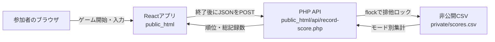

# Computer Typing Arena
## XServerアップロード・運用ガイド

この文書は、ブラウザ向けタイピングゲーム **Computer Typing Arena** を、XServerのレンタルサーバー上で公開し、CSVベースのスコア記録とモード別ランキングを運用するための手順書です。ゲーム画面は静的ファイルとして公開し、結果記録だけを同じドメイン上のPHP APIが受け取る構成です。

> **重要:** `scores.csv` は必ず `public_html` の外に置いてください。公開フォルダに配置すると、URLを知る第三者に記録を閲覧されるおそれがあります。

---

## 1. 構成の概要

ゲームはReactで作られたフロントエンドと、XServerで動くPHP記録APIで構成されています。プレイ終了後、ブラウザは同じドメインの `api/record-score.php` にJSONを送信します。PHP APIはCSVを排他ロックして追記し、基本モードとハードモードを別々に集計して順位を返します。



| 要素 | 役割 | 公開範囲 |
|---|---|---|
| Reactアプリ | タイピング画面、振り返り、結果画面を表示する。 | 公開 |
| PHP API | 入力値の検証、CSV追記、順位計算、二重送信防止を行う。 | 公開。ただしPOSTのみ受け付ける。 |
| `scores.csv` | ニックネーム、スコア、WPM、精度、モード、プレイIDなどの記録を保持する。 | **非公開** |
| `.rate_*` | APIが短時間の過剰送信を抑えるために作成する一時的なIP別状態ファイル。 | **非公開** |
| `.htaccess` | ファイル一覧を無効化し、SPAの画面直アクセスを処理する。 | 設定ファイル |

---

## 2. 開発プロジェクト内の主なファイル構成

以下は、運用・改修・公開時に確認する主なファイルです。`client/src/components/ui/` 以下の多数の共通UI部品は、通常のアップロード作業で直接操作する必要はありません。

```text
computer-typing-arena/
├── client/
│   └── src/
│       ├── App.tsx                         # /、/glossary、/result のルーティング
│       ├── components/
│       │   ├── GameCanvas.tsx              # 開始画面・ゲーム中の入力・匿名開始
│       │   └── GameCanvas.css              # ゲーム画面の表示スタイル
│       ├── pages/
│       │   ├── GlossaryPage.tsx            # 出題語とミスタイプの振り返り
│       │   ├── ResultPage.tsx              # 結果、順位、記録状態
│       │   └── ResultPage.css
│       └── game/
│           ├── basicPrompts.ts             # 基本モードの日常語とローマ字表記
│           ├── termBank.generated.ts       # ハードモードの2,000語
│           ├── TypingSession.ts            # 正誤判定と採点
│           ├── resultStore.ts              # 結果をsessionStorageに一時保存
│           └── scoreApi.ts                 # PHP APIへのPOST処理
├── xserver/
│   ├── public_html/
│   │   ├── .htaccess                       # SPA直アクセス・一覧表示防止
│   │   └── api/
│   │       └── record-score.php            # CSV記録・ランキング用PHP API
│   └── private/
│       ├── .htaccess                       # 非公開フォルダの直接アクセス拒否
│       └── scores.csv                      # 初期CSV（ヘッダーのみ）
├── scripts/
│   └── verify-xserver-score-api.sh         # XServer想定のAPI総合テスト
├── XSERVER_DEPLOYMENT.md                   # 短縮版の設置ガイド
├── XSERVER_UPLOAD_GUIDE.md                 # 本文書
├── package.json                            # ビルド・型チェック用スクリプト
└── dist/public/                            # pnpm buildで生成される公開用ファイル
```

> `dist/public/` はビルドのたびに生成されるため、開発中に手作業で編集しません。ソースを直してから再ビルドし、その出力をアップロードしてください。

---

## 3. XServer上で完成させるファイル構成

ドメインのルートを `~/your-domain/` と表記します。実際のアカウントでは、該当ドメインのフォルダ名に読み替えてください。

```text
~/your-domain/
├── public_html/                            # URLから公開される場所
│   ├── index.html                          # dist/public/ のファイル一式
│   ├── assets/                             # dist/public/assets/ のファイル一式
│   ├── .htaccess                           # xserver/public_html/.htaccess
│   └── api/
│       └── record-score.php                # xserver/public_html/api/record-score.php
└── private/                                # public_htmlの外。URLから非公開
    ├── .htaccess                           # xserver/private/.htaccess
    ├── scores.csv                          # xserver/private/scores.csv
    └── .rate_...                           # APIが実行時に自動作成する場合がある
```

| XServer上の配置先 | アップロード元 | 注意点 |
|---|---|---|
| `public_html/` | `dist/public/` の**中身すべて** | `dist/public` フォルダ自体を二重に作らない。`index.html` が `public_html/index.html` になるようにする。 |
| `public_html/.htaccess` | `xserver/public_html/.htaccess` | ビルド出力には含まれないため、別途アップロードが必要。隠しファイル表示を有効にする。 |
| `public_html/api/record-score.php` | `xserver/public_html/api/record-score.php` | `api` フォルダを作って配置する。 |
| `private/scores.csv` | `xserver/private/scores.csv` | **`public_html` の外側**に置く。初回はヘッダーだけの状態でよい。 |
| `private/.htaccess` | `xserver/private/.htaccess` | `private` が誤って公開位置に作られた場合にも、直接アクセスを拒否する。 |

---

## 4. アップロード前の準備

### 4.1 必要なもの

開発PCまたはこの開発環境で、Node.js、pnpm、PHP CLI、curlが使える状態を想定しています。XServer側ではPHP 8系を選択してください。XServerはPHPバージョンをサーバーパネルから切り替えられ、PHP 8系を提供しています。[1]

### 4.2 ビルドと事前確認

プロジェクトのルートで、次の順に実行します。Windowsの場合は、Node.jsのメモリ指定が不要な場合もありますが、ビルドエラーが起きる場合は同等のメモリ設定を行ってください。

```bash
cd /path/to/computer-typing-arena
pnpm install --frozen-lockfile
pnpm check
NODE_OPTIONS=--max-old-space-size=1536 pnpm build
scripts/verify-xserver-score-api.sh
```

各コマンドの目的は次のとおりです。

| コマンド | 成功の目安 | 失敗時の対応 |
|---|---|---|
| `pnpm check` | TypeScriptエラーがない。 | 表示されたソースファイルを修正して再実行する。 |
| `pnpm build` | `dist/public/` が生成される。 | `dist/public/` を手動編集せず、依存関係とソースを確認する。 |
| `scripts/verify-xserver-score-api.sh` | `PASS:` で始まる成功メッセージが出る。 | PHP、curl、実行権限を確認する。 |

この総合テストでは、XServerと同じく `public_html` と `private` が兄弟フォルダである構成を一時作成し、PHP APIをHTTP経由で検証します。ゲスト記録、基本・ハード別の順位、同点、旧CSVの移行、再読み込み時の二重送信防止、同時書き込み、不正入力・異なる送信元の拒否、共有Wi-Fiからの短時間バーストを確認します。

---

## 5. XServerへのアップロード手順

### 手順 1: ドメインとPHPを準備する

XServerのサーバーパネルで対象ドメインを追加し、公開先が `public_html` となる状態にします。続いて **PHP Ver.切替** から、対象ドメインをPHP 8系へ設定します。[1]

### 手順 2: 公開ディレクトリへビルド成果物を配置する

FTPソフトまたはXServerのファイルマネージャで `dist/public/` の中身を、対象ドメインの `public_html/` にアップロードします。ファイルマネージャではアップロード、フォルダ作成、展開、パーミッション変更をブラウザから行えます。[2]

**正しい例**は `public_html/index.html` です。`public_html/dist/public/index.html` になっている場合は、フォルダを一段深くアップロードしているため、配置をやり直してください。

### 手順 3: PHP APIと公開用設定を配置する

`public_html/api/` を作成し、`xserver/public_html/api/record-score.php` を置きます。次に、`xserver/public_html/.htaccess` を `public_html/.htaccess` としてアップロードします。

この `.htaccess` は、ファイル一覧を無効化するとともに、Reactの画面遷移先である `/glossary` と `/result` を直接開いたときに `index.html` へ渡します。既存の `.htaccess` がある場合は、内容を消さずに、既存のリダイレクトやCMSの設定と衝突しないよう統合してください。XServerは `.htaccess` による設定を案内しています。[3]

### 手順 4: 非公開の記録フォルダを作成する

`public_html` の**外側**に `private/` を作成します。その中へ、以下の2ファイルをアップロードします。

```text
private/.htaccess
private/scores.csv
```

PHP APIは、`public_html/api/record-score.php` から親フォルダをたどって `private/scores.csv` を参照します。そのため、`private` を `public_html` の内側に置くと、記録先を見つけられず、結果画面に記録失敗が表示されます。

### 手順 5: パーミッションを設定する

XServer公式の推奨値に従い、フォルダは `755` または `705`、HTML・PHP・`.htaccess` は `644`、CSVなどのデータファイルは `600` に設定します。[4]

| 対象 | 推奨パーミッション | 理由 |
|---|---:|---|
| `public_html/`、`public_html/api/` | `755` | Webサーバーが公開ファイルを参照できるようにする。 |
| `private/` | `705` または `755` | PHPがCSVと送信制限ファイルを読み書きできるようにする。 |
| `public_html/api/record-score.php` | `644` | PHPスクリプトとして読み込ませる。 |
| 両方の `.htaccess` | `644` | Webサーバーに設定を読み込ませる。 |
| `private/scores.csv` | `600` | 記録データを所有者だけが読み書きできるようにする。 |

`private/` はPHPから書き込める必要があります。権限を設定しても結果記録が失敗する場合は、フォルダの所有者や設置場所が対象ドメインと一致しているかを最初に確認してください。

---

## 6. 公開後の動作確認手順

アップロード直後は、PCとスマートフォンの両方で以下を確認してください。テスト用スコアが残るため、文化祭本番前には `scores.csv` をヘッダーだけの初期ファイルに戻すか、テスト記録を必要に応じて削除してください。

| 手順 | 操作 | 期待結果 |
|---:|---|---|
| 1 | `https://あなたのドメイン/` を開く。 | 開始画面が表示される。 |
| 2 | ニックネームを空欄にし、基本モードで30秒プレイする。 | 結果画面でゲストとして記録完了・順位が表示される。 |
| 3 | ハードモードで1回プレイする。 | 基本モードとは別の記録数・順位が表示される。 |
| 4 | 直前の結果画面を再読み込みする。 | 記録数は増えず、同じ順位が返る。通信は通常 `200 OK`。 |
| 5 | もう一度別のプレイを終了する。 | 初回送信は通常 `201 Created`、CSVに1行だけ追加される。 |
| 6 | `https://あなたのドメイン/glossary` と `/result` を直接開く。 | サーバーの404ではなく、Reactアプリとして画面が処理される。 |
| 7 | `https://あなたのドメイン/private/scores.csv` を開こうとする。 | CSVをダウンロード・表示できない。 |

ブラウザの開発者ツールの「ネットワーク」では、`api/record-score.php` の応答を確認できます。初回の結果送信は `201 Created`、同じプレイIDでの再読み込みは `200 OK` となり、いずれもJSONの `ok: true`、`rank`、`totalRecords` が返ります。

> 文化祭会場では、複数端末が同じWi-Fi・同じグローバルIPを使うことがあります。本APIは、同一IPから10秒間に30件までの新規記録を許可します。通常の連続プレイを妨げず、過剰な自動送信だけを抑える設定です。

---

## 7. ランキングとCSVの仕様

### 7.1 順位の決め方

ランキングは**モード別**です。基本モードとハードモードの記録は混ざりません。同一モードのスコアを比較し、自分より高いスコアの件数に1を足した順位を返します。したがって同点は同順位です。

| 同一モードのスコア | 表示順位 |
|---:|---:|
| 1,000 | 1位 |
| 850 | 2位 |
| 850 | 2位 |
| 600 | 4位 |

### 7.2 CSVの列

```csv
recorded_at_jst,nickname,score,wpm,accuracy_percent,completed_terms,best_streak,duration_seconds,mode,play_id
```

| 列名 | 内容 |
|---|---|
| `recorded_at_jst` | PHPサーバーが記録した日本時間。 |
| `nickname` | 参加者名。空欄で開始した場合は `ゲスト`。 |
| `score` | 最終スコア。 |
| `wpm` | 入力速度。 |
| `accuracy_percent` | 正確さ（0〜100）。 |
| `completed_terms` | 完了した出題数。 |
| `best_streak` | 最大連続正解数。 |
| `duration_seconds` | 選択した計測時間。 |
| `mode` | `basic` または `hard`。 |
| `play_id` | 再送・再読み込み時の重複登録を防ぐ一意なID。 |

旧形式のCSVに `mode` 列がない場合、APIは既存行をハードモードとして一度だけ移行します。本番中にCSVをExcelなどで開いたままにしたり、列の順序を変えたりしないでください。

---

## 8. トラブルシューティング

| 症状 | 主な原因 | 確認・対処 |
|---|---|---|
| 結果画面で「記録に失敗」と表示される。 | `private` の位置または書き込み権限が不正。 | `private` が `public_html` の外にあること、`private` が `705/755`、CSVが `600` であることを確認する。 |
| APIが `500` を返す。 | PHPがCSVへ書き込めない。 | `private/` と `scores.csv` の配置・パーミッションを確認する。XServerのエラーログも確認する。 |
| APIが `403` を返す。 | 異なるドメインからAPIを呼び出している。 | ゲームとPHP APIを同じドメイン・同じプロトコルで公開する。外部ドメインにAPIを移さない。 |
| APIが `415` を返す。 | JSON以外のリクエストになっている。 | フロントエンドの `scoreApi.ts` を変更していないか確認する。 |
| APIが `422` を返す。 | ニックネーム、モード、数値、プレイIDの形式が不正。 | ブラウザで改造したリクエストではなく、正規のゲーム画面から送信しているか確認する。 |
| APIが `429` を返す。 | 10秒に30件を超える送信が同一IPから来た。 | 少し待ってから再試行する。通常の手動プレイでは起こりにくい設定。 |
| `/glossary` や `/result` が404になる。 | `public_html/.htaccess` が未配置、または設定が上書きされた。 | `xserver/public_html/.htaccess` をアップロードし、既存設定と統合する。 |
| CSSやJavaScriptが読み込まれない。 | `dist/public/` の中身ではなくフォルダ自体をアップロードした。 | `public_html/index.html` と `public_html/assets/` になるよう、アップロード先を修正する。 |
| ランキングが意図より多い。 | テスト記録がCSVに残っている。 | 本番開始前にCSVをバックアップし、ヘッダー行だけの初期ファイルへ差し替える。 |

---

## 9. 本番日の運用チェックリスト

- [ ] `pnpm check`、`pnpm build`、`scripts/verify-xserver-score-api.sh` が成功している。
- [ ] `dist/public/` の中身を `public_html/` へ配置した。
- [ ] `public_html/.htaccess` と `private/.htaccess` を配置した。
- [ ] `record-score.php` を `public_html/api/` に配置した。
- [ ] `private/` を `public_html` の外に配置し、`scores.csv` を置いた。
- [ ] `private`、`scores.csv`、PHP、`.htaccess` のパーミッションを確認した。
- [ ] PHP 8系を対象ドメインに設定した。
- [ ] ゲスト・基本モード・ハードモードで各1回テストした。
- [ ] 結果画面の再読み込みで重複記録されないことを確認した。
- [ ] 本番開始前に `scores.csv` をバックアップし、不要なテスト記録を整理した。
- [ ] 参加者に、ニックネームと結果を記録する目的・保管方法を案内した。

文化祭終了後は、`private/scores.csv` をダウンロードして安全な場所に保管してください。次回イベント用に記録をリセットする場合も、必ず原本をバックアップしてから初期CSVへ差し替えます。ニックネームは個人情報になり得るため、実名や連絡先の入力を促さない運用を推奨します。

---

## 参考資料

[1]: https://www.xserver.ne.jp/manual/man_program_php_ver.php "XServer：PHPのバージョンについて"
[2]: https://www.xserver.ne.jp/manual/man_tool_file.php "XServer：ファイルマネージャ"
[3]: https://www.xserver.ne.jp/manual/man_server_htaccess.php "XServer：.htaccess"
[4]: https://www.xserver.ne.jp/manual/man_server_permission.php "XServer：パーミッション"
