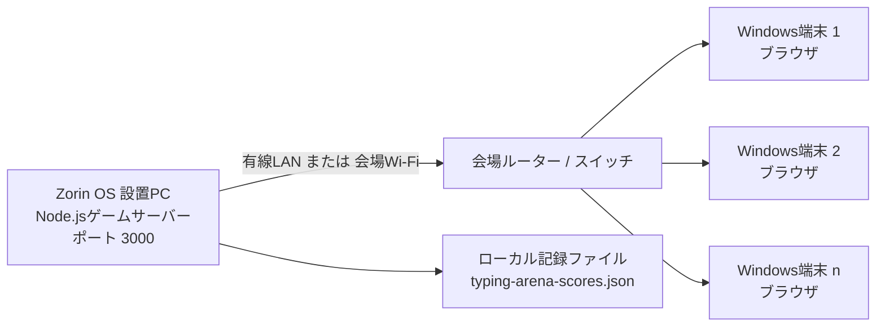

# Computer Typing Arena
## Zorin OS会場内サーバー運用ガイド

このガイドは、部室に設置したZorin OS PCをゲームサーバーとして稼働させ、同じ校内LANまたは専用ルーターに接続した複数のWindows端末から、共通ランキング付きのタイピングゲームを利用するための手順書です。会場での運用では、設置PCだけが記録を保存し、Windows端末はブラウザでアクセスするだけです。

> **この構成ではXServer、PHP、外部のMySQLサーバーは不要です。** Zorin OS上のNode.jsサーバーがゲーム画面と記録APIを同時に提供し、ランキングは設置PC内の `typing-arena-scores.json` に保存します。イベント中にインターネット接続が切れても、LANと設置PCが動作していればゲームとランキングは使えます。

---

## 1. 会場構成



| 要素 | 役割 | 重要な条件 |
|---|---|---|
| Zorin OS設置PC | Node.jsサーバー、ゲーム画面、共有ランキングを提供する。 | イベント中は電源を切らず、スリープを無効にする。 |
| ルーター／スイッチ | 設置PCとWindows端末を同じネットワークへ接続する。 | 端末間通信を遮断する「クライアント分離」を無効にする。 |
| Windows端末 | Webブラウザでゲームを開く。 | 同じLANへ接続し、指定されたURLを開く。 |
| ローカル記録 | 全端末共通のランキングデータ。 | `/var/lib/computer-typing-arena/typing-arena-scores.json` を定期的にバックアップする。 |

設置PCは `0.0.0.0` で待ち受けるため、同一LAN内の端末からアクセスできます。Windows端末ごとにソフトウェアを入れる必要はありません。アクセス先は `http://設置PCのIPアドレス:3000/` です。

---

## 2. 保存方式とランキングの仕様

Zorin OS版は、環境変数 `DATABASE_URL` が設定されていない場合に、ローカルJSONファイルを自動作成して記録します。Node.jsサーバーは1プロセスで動かす前提で、各記録を同期的に処理してから一時ファイルを置き換えるため、複数端末が同時に終了しても1行ずつ整合した状態で保存されます。

| 項目 | Zorin OS会場版の仕様 |
|---|---|
| 記録先 | `/var/lib/computer-typing-arena/typing-arena-scores.json` |
| 外部DB | 不要。`DATABASE_URL` は設定しない。 |
| ランキング | 基本モードとハードモードを別々に集計する。 |
| 同点 | 同順位。たとえば 1位、2位、2位、4位となる。 |
| 二重記録 | `playId` が同じ再読み込み・再送は新規追加せず、同じ順位を返す。 |
| 送信元確認 | ブラウザの `Origin` とアクセス先ホストが一致する場合のみ記録する。 |
| 同時記録 | Node.jsの単一プロセスが順番に処理する。複数プロセスを同時に起動しない。 |

> **注意:** JSON記録を確実に保護するため、ゲームサーバーはsystemdで1つだけ起動してください。`pnpm start:lan` を別ターミナルから重ねて実行しないでください。

---

## 3. 事前準備

### 3.1 ネットワークを固定する

会場では、Zorin OS PCとWindows端末を同じルーターまたはスイッチにつなぎます。可能であれば、ゲームサーバーPCは有線LANを使ってください。無線のみの場合も動作しますが、設置PCはルーターの近くに置きます。

設置PCのIPアドレスがイベント中に変わると、参加端末のURLが使えなくなります。ルーター側でDHCP予約を設定するか、Zorin OSのネットワーク設定で固定IPを設定してください。例として、設置PCが `192.168.10.25` の場合、参加者は次のURLを開きます。

```text
http://192.168.10.25:3000/
```

Zorin OSのターミナルで現在のIPアドレスを確認するには、次を実行します。

```bash
hostname -I
```

### 3.2 Node.jsとpnpmを用意する

Zorin OSには、Node.js **22 LTS** とpnpmが必要です。Node.js公式サイトまたはNodeSourceのUbuntu向け手順を使って、システム全体にNode.jsを入れてください。[1] Zorin OSはUbuntu系のため、Ubuntu向けのパッケージ手順を使えます。

Node.js導入後、ターミナルで次を確認します。

```bash
node --version
corepack enable
corepack prepare pnpm@10.4.1 --activate
pnpm --version
```

`node --version` が `v22` から始まること、`pnpm --version` が表示されることを確認してください。systemdで自動起動するため、nvmのようにログイン時だけ有効になるNode.jsではなく、OS全体で使えるNode.jsを推奨します。

### 3.3 ゲームを設置する

プロジェクトのZIPをZorin OS PCへコピーして展開するか、GitHubから取得します。以下では、設置先を `/opt/computer-typing-arena` とします。

```bash
sudo mkdir -p /opt/computer-typing-arena
sudo chown "$USER":"$USER" /opt/computer-typing-arena
cd /opt/computer-typing-arena
# このフォルダへプロジェクトファイルを配置する
pnpm install --frozen-lockfile
NODE_OPTIONS=--max-old-space-size=1536 pnpm run build:lan
pnpm run verify:lan
```

`build:lan` はReactアプリとNode.jsサーバーをビルドし、デザインに使う画像も `dist/public/manus-storage/` に同梱します。そのため、ビルド時はインターネットに接続してください。ビルドが完了した後は、イベント中にインターネット接続は不要です。

`verify:lan` は、設置PC内でローカル記録、基本／ハード別ランキング、同点、同時記録、二重送信防止、同一LANオリジン確認を自動テストします。`PASS:` が表示されてから、次の手順へ進んでください。

---

## 4. 初回起動とWindows端末からの確認

最初はsystemdを設定する前に、手動で起動してLAN接続を確認します。

```bash
cd /opt/computer-typing-arena
pnpm run start:lan
```

別の端末で次のURLを開きます。

```text
http://設置PCのIPアドレス:3000/
```

Windows端末では、Chrome、Edge、Firefoxのいずれかで開けます。開かない場合は、設置PC上で `http://127.0.0.1:3000/` を開いてサーバー起動を確認してから、ファイアウォールとLAN設定を確認してください。

### UFWの設定

UFWを有効にしている場合は、ゲーム用ポート3000を**会場のLAN範囲だけ**に許可します。たとえば会場ネットワークが `192.168.10.0/24` なら、次を実行します。UFWは特定のネットワークからポートへのアクセスを許可できます。[2]

```bash
sudo ufw allow proto tcp from 192.168.10.0/24 to any port 3000
sudo ufw status numbered
```

ルーターのネットワーク帯が異なる場合は、`192.168.10.0/24` を実際の値に置き換えます。ネットワークが不明なまま、ポート3000をインターネット全体へ許可しないでください。

確認後、手動サーバーは `Ctrl+C` で停止します。

---

## 5. 自動起動の設定

イベント当日は、Zorin OS PCの再起動後もゲームサーバーが自動で立ち上がるようsystemdへ登録します。systemdの`.service`ファイルは、プロセスの起動と監視を定義するための設定です。[3]

最初に専用ユーザーとデータ保存先を作ります。

```bash
sudo useradd --system --home /opt/computer-typing-arena --shell /usr/sbin/nologin typingarena
sudo mkdir -p /var/lib/computer-typing-arena
sudo chown typingarena:typingarena /var/lib/computer-typing-arena
sudo chmod 700 /var/lib/computer-typing-arena
```

続いて、同梱のサービス定義をコピーします。

```bash
sudo cp /opt/computer-typing-arena/deploy/systemd/computer-typing-arena.service /etc/systemd/system/
sudo systemctl daemon-reload
sudo systemctl enable --now computer-typing-arena.service
sudo systemctl status computer-typing-arena.service
```

`active (running)` と表示されれば起動しています。ユニット定義の `ExecStart=/usr/bin/node` は、`command -v node` の結果が異なる場合だけ、その実際のパスへ変更してください。サービスを変更した後は必ず `sudo systemctl daemon-reload` を実行します。

| 操作 | コマンド |
|---|---|
| 状態を確認 | `sudo systemctl status computer-typing-arena.service` |
| ログを確認 | `sudo journalctl -u computer-typing-arena.service -f` |
| 停止 | `sudo systemctl stop computer-typing-arena.service` |
| 起動 | `sudo systemctl start computer-typing-arena.service` |
| 再起動 | `sudo systemctl restart computer-typing-arena.service` |
| 自動起動を解除 | `sudo systemctl disable --now computer-typing-arena.service` |

---

## 6. イベント当日の確認手順

まず設置PCで、サービスの状態を確認します。

```bash
sudo systemctl is-active computer-typing-arena.service
hostname -I
```

`active` と表示されたら、Windows端末で `http://設置PCのIPアドレス:3000/` を開きます。各端末で次の確認を行ってください。

| 順番 | 確認すること | 期待結果 |
|---:|---|---|
| 1 | 開始画面を開く。 | ゲーム画面と背景画像が表示される。 |
| 2 | ニックネームを空欄にして30秒の基本モードを終える。 | 結果画面で「ゲスト」と表示され、ランキング順位と記録完了が表示される。 |
| 3 | 別のWindows端末で基本モードを終える。 | 同じ基本モードの総記録数・順位へ反映される。 |
| 4 | ハードモードを終える。 | 基本モードとは別のランキングになる。 |
| 5 | 直前の結果画面を更新する。 | 記録数が増えず、同じ順位が表示される。 |

会場PCが再起動した場合も、同じURLでアクセスできます。ただしIPアドレスを固定していない場合は変わることがあるため、設置PCで `hostname -I` を再確認してください。

---

## 7. バックアップとリセット

ランキングデータは1ファイルです。イベント前、休憩時、終了後にバックアップしてください。

```bash
sudo cp /var/lib/computer-typing-arena/typing-arena-scores.json \
  "/var/lib/computer-typing-arena/typing-arena-scores-$(date +%Y%m%d-%H%M%S).json"
```

ランキングを初期化する場合は、必ずバックアップを取ってからサービスを停止し、空の配列へ置き換えます。

```bash
sudo systemctl stop computer-typing-arena.service
printf '[]\n' | sudo tee /var/lib/computer-typing-arena/typing-arena-scores.json > /dev/null
sudo chown typingarena:typingarena /var/lib/computer-typing-arena/typing-arena-scores.json
sudo chmod 600 /var/lib/computer-typing-arena/typing-arena-scores.json
sudo systemctl start computer-typing-arena.service
```

> 記録にはニックネームとプレイ成績が含まれます。実名・連絡先を入力しない案内を出し、イベント終了後はバックアップファイルの保管場所と削除時期を決めてください。

---

## 8. 典型的な問題

| 症状 | 主な確認箇所 | 対処 |
|---|---|---|
| Windows端末で開けない | IPアドレス、同一LAN、UFW、クライアント分離 | `hostname -I` でIPを再確認し、ポート3000を会場LANに許可する。 |
| 設置PCでは開けるが他端末で開けない | `HOST=0.0.0.0`、UFW | `pnpm run start:lan` またはsystemd設定で待受ホストを確認する。 |
| 結果画面で記録失敗になる | サービスのログ、データフォルダ権限 | `sudo journalctl -u computer-typing-arena.service -n 80` を確認し、`/var/lib/computer-typing-arena` の所有者を確認する。 |
| ランキングが端末ごとに異なる | URLのホスト表記 | すべての端末で、同じ `http://IPアドレス:3000/` を使う。IPとPC名を混在させない。 |
| 背景画像が表示されない | LAN用ビルド | インターネット接続下で `pnpm run build:lan` を実行し直す。 |
| 記録が消えた | 保存先の初期化・再設置 | `/var/lib/computer-typing-arena/` のバックアップを復元する。 |

---

## 参考資料

[1]: https://nodejs.org/en/download "Node.js Downloads"
[2]: https://ubuntu.com/server/docs/how-to/security/firewalls/ "Ubuntu Server documentation: Firewall"
[3]: https://www.freedesktop.org/software/systemd/man/systemd.service.html "systemd.service"
